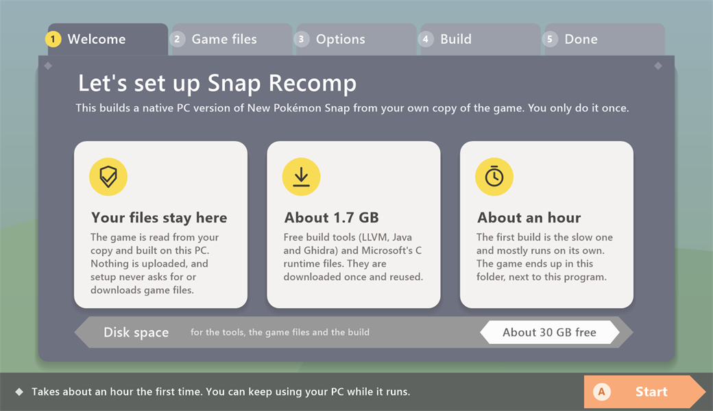
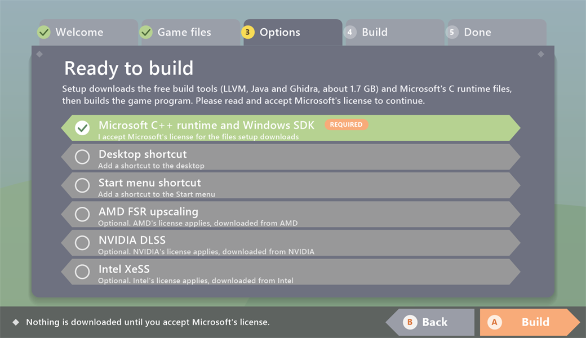
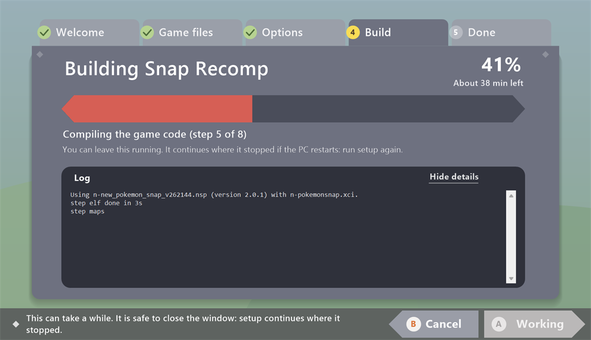
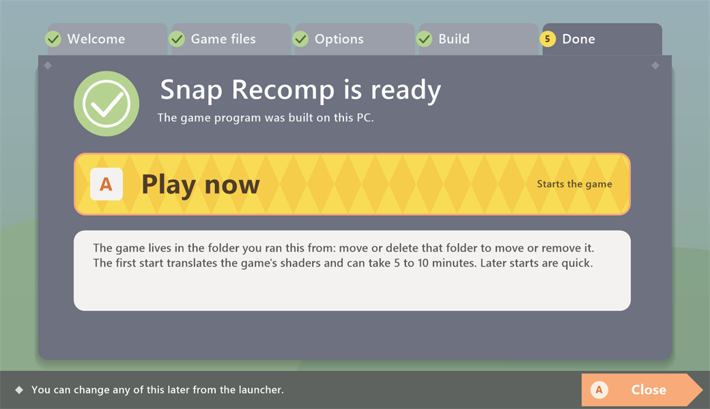

# Snap Recomp Builder for Windows

Works with your own copy of New Pokémon Snap 2.0.1.

This builder turns your own copy of the game into a native Windows program. It reads three things you supply, translates the game's code on your PC, compiles it, and links it with the prebuilt runtime that ships with this project. The result is `SnapRecomp.exe`.

The project contains no game data and does not help you get any. You need a legal copy of the game, version 2.0.1, and you extract the files from it yourself with your own tools.

You can build two ways. `SnapRecomp.exe` (on the release page) is a one-click window until the game is built: pick your game folder and press Build (see "One-click setup" below). After the build the same exe starts the game. The command line, described in the rest of this file, does the same job. The finished `SnapRecomp.exe` is its own launcher with a window: Play, settings, saves, mods, HD textures, Add to Steam and updates (see "Starting the game" below).

## One-click setup

`SnapRecomp.exe` finds your game files, downloads the pinned build tools and builds the game into its own folder. It needs no terminal, no Python and no Visual Studio. Desktop and Start menu shortcuts are options that start unticked, and setup adds nothing to Windows' installed-apps list ([docs/install-folder.md](../docs/install-folder.md)). The game folder can hold the extracted `main`, `sdk` and RomFS, or your dumped base game (XCI or NSP), your update NSPs and your `prod.keys`. With a raw dump, setup picks the base game and the 2.0.1 update by title ID, ignores older updates and extracts only what it needs into its own work folder. It reads your dump and keys in place: keys are never copied and never written to a log. The Microsoft C runtime and Windows SDK files come from Microsoft after you accept their license in the wizard. Plan on about 30 GB of free disk space and about an hour for the first build. Setup also repairs and uninstalls.

<p align="center">
  
  
</p>
<p align="center">
  
  
</p>

The wizard runs `python builder/snap_builder.py setup scan|run|repair|uninstall`, which prints one JSON object per line. The screenshots use sample text for the game files and the progress.

## What you supply

For the command-line build, extract with your own tools, from your own copy of game version 2.0.1 (the base game with the 2.0.1 update applied):

1. `main`, the program's main module file (an NSO).
2. `sdk`, the second module file from the same folder (an NSO).
3. The patched RomFS, extracted to a folder.

The builder accepts compressed or decompressed module files. It checks all three against the published 2.0.1 values before it does anything slow, and it stops with a plain message if something is wrong. Examples: a folder instead of a file, a file that is still encrypted, a module from an older version, a RomFS that has only the base game.

Nothing you supply is copied, uploaded or shipped. The builder reads your files and writes only inside the work folder you name.

## Requirements

| Need | Notes |
|---|---|
| Windows 10 or 11, 64-bit | The PC needs AVX2 (any CPU since about 2015). |
| Vulkan 1.3 graphics driver | To run the game. Needed for the smoke test at the end of the build. |
| LLVM 23 (clang and lld) | Pass its `bin` folder with `--llvm`, or let `fetch` download it (see "Fetching the tools"). |
| Microsoft C runtime and Windows SDK files | Either Visual Studio Build Tools 2022 (free from Microsoft) or the files the `winsdk` command fetches (see "Fetching the tools"). `--winsdk auto` uses Visual Studio when it is installed. The final link needs these system libraries. |
| Python 3.14 | With `capstone`, `pyelftools`, `numpy` and `lz4`. Pass it with `--python`, or let `pyenv` build one. |
| Function lists, or Ghidra | See "Function lists" below. |
| Disk and memory | About 3 GB of free disk for the work folder. 8 GB of RAM is the minimum for the build. The Ghidra step needs 16 GB or more (12 GB heap). |

## Fetching the tools

Every tool the build needs is pinned in `builder/versions.json` with its download URL, its SHA-256 and a note saying where that hash was published (the release page or the publisher's checksum file). Two commands use the pins:

```
python builder/snap_builder.py fetch --list
python builder/snap_builder.py fetch llvm ghidra switch_loader jdk
python builder/snap_builder.py pyenv
```

- `fetch` asks before every download, shows the URL and the size, checks the SHA-256 while the file arrives, and deletes the file if it does not match. `--yes` answers yes to every question. Without a terminal and without `--yes` it downloads nothing.
- Files you already have are used without asking when their hash matches. `--offline-dir <folder>` points at a folder of downloaded files, so a PC without internet can use them.
- Tools unpack into the `tools` folder next to the downloaded exe, or into `%LOCALAPPDATA%\SnapRecomp\tools` when the builder runs from a source checkout (change it with `--tools-dir`). An install with no `tools` folder yet reuses the tools an older version left in `%LOCALAPPDATA%`.
- `winsdk --accept-license` fetches the Microsoft C runtime and Windows SDK files with the pinned xwin, from Microsoft's own servers, after you accept Microsoft's license (the license link is in `python builder/snap_builder.py winsdk --help`). Use it when Visual Studio Build Tools is not installed. `build --winsdk vs|xwin|auto` chooses the source, and `auto` (the default) takes Visual Studio first.
- `pyenv` builds a Python with `capstone`, `pyelftools`, `numpy` and `lz4` from pinned wheels. pip runs with `--require-hashes`, `--no-deps` and `--no-index`, so it installs only the pinned files. It uses the pinned python.org embeddable Python, or `--base-python <python.exe>` makes a venv of Python 3.14 you already have.
- The download sizes are large: LLVM is about 0.9 GB, Ghidra 0.6 GB and the JDK 0.2 GB. Ghidra, its Switch loader and the JDK are only needed when you do not pass `--maps`.
- No Vulkan SDK is needed. The prebuilt folder carries a small import library for the Vulkan loader, which comes with your graphics driver.

## Use

Check your files first (takes about a second):

```
python builder/snap_builder.py check --main <main> --sdk <sdk> --romfs <romfs folder>
```

Full install check, in plain words (game files and the built program; every part is optional):

```
python builder/snap_builder.py check --install-check --main <main> --sdk <sdk> --romfs <romfs folder> --install-dir <out folder>
```

Build:

```
python builder/snap_builder.py build --main <main> --sdk <sdk> --romfs <romfs folder> --work <new empty folder> --maps <folder with the two function lists>
```

Useful options: `--jobs N` (parallel compiles), `--llvm`, `--python`, `--prebuilt`, `--skip-smoke`, `--force <step>` (rerun one step).

The work folder holds everything the build makes: the converted modules, the function lists, the generated C, the compiled libraries, the log (`builder.log`) and `out/`. `out/SnapRecomp.exe` is the result, with its DLLs, the `shader_harness` folder and a `config.json` that records the RomFS folder.

A rebuild never touches a working `out/` until the new build is proven. The builder assembles the new build in `builds/<id>`, checks it (a real 64-bit exe, the DLL hashes, the harness, a `config.json` that points at files that exist), starts it and waits for the title screen. Only then does it switch `out/` to the new build. The old one stays in `builds/previous`, and `current.json` names the active build. If the check or the smoke run fails, `out/` stays as it was and the log says where the new build is. Close the game before you rebuild: Windows will not rename a folder that a running game holds open.

## Steps

Each step records what it used. If you run the builder again with the same work folder, finished steps are skipped, and an interrupted compile resumes where it stopped.

The function lists and the generated C are also kept in a private cache, the `cache` folder next to the downloaded exe or `%LOCALAPPDATA%\SnapRecomp\cache` for a source checkout (`--cache-dir` moves it, `--no-cache` skips it). Entries are keyed on the hashes of your game files and the builder's own inputs, so a new work folder with the same game files restores them instead of running Ghidra or the lifter again. The cache holds game-derived files on your PC only. It refuses a folder it did not create, keeps two entries per kind and stays under 1 GiB.

Binary patches are off in this release. If a `builder/patches/` folder ever holds patch files, the builder applies only those listed in `reviewed.json`, only to a module whose hash and build ID match, and only where the original bytes match.

1. Preflight: Windows, CPU features, free disk, RAM, tools.
2. Version check: module build IDs, a hash of each decompressed module, and a RomFS file list check.
3. Convert the two modules to ELF files (`scripts/nso2elf.py`).
4. Function lists (see below).
5. Generate C for `main` and `sdk` (`recomp/snap_gen.py`, about half a minute).
6. Compile the generated C in parallel with clang.
7. Link the generated code, the prebuilt runtime objects in `prebuilt/` and the system libraries into `SnapRecomp.exe`.
8. Write `config.json` and the published file check the launcher uses, into the new build folder.
9. Self-test, then a smoke run: start `SnapRecomp.exe` the way a double-click does, on a scratch profile, and wait for the title screen. Then switch `out/`.

## Starting the game

Double-click `SnapRecomp.exe` in the `out` folder. With no command-line arguments, and a `config.json` next to it, the program is its own launcher:

- It checks the RomFS folder from `config.json` against the published file check every time it starts. If the drive is missing or the folder is wrong, it says so in plain words.
- A small window offers Play, "Change game folder...", "Open save folder", save import and export, upscalers and Updates.
- Play passes the converted game files and the RomFS path to the game, with no arguments from you.
- The first launch translates the game's shaders with the `shader_harness` program next to the exe (a self-contained build of the MIT-licensed Ryubing shader translator; its notice is in `shader_harness`). Translated shaders go to `%LOCALAPPDATA%\SnapRecomp\nvn_cache`, so the first start takes several minutes and later starts are fast. The log shows a progress line every 100 shaders.
- Logs go to `portable_data\Local\SnapRecomp\logs` next to the built exe (`%LOCALAPPDATA%\SnapRecomp\logs` for a development build). The icon is an original fallback icon, not the game's.

## Function lists

The code translation needs two lists of addresses, `functions_final.tsv` and `jump_tables.tsv`. They describe your game files, so they are made on your PC and never shipped.

- With `--maps <folder>` the builder uses lists you already have.
- Without it, the builder runs Ghidra 12.1.2 headless (with its Switch loader extension and JDK 21; pass `--ghidra` and `--jdk`). That takes about 13 minutes and a 12 GB heap. The `scripts/ghidra/` scripts do the work.

The Ghidra path has been run end to end: the lists it produced matched the ones from the development pipeline, and the game reached its title screen. It took about 28 minutes on a PC that was busy with other work, so plan for 15 to 30 minutes the first time. The lists are cached (see below), so a rebuild with the same game files skips Ghidra.

## What is in the prebuilt folder

Our own runtime, host code, the launcher, mods, the settings overlay and the upscaler glue, compiled to plain object files, plus the self-contained shader harness. No game bytes are in them. `builder/release_prebuilt.py` makes the folder, and `builder/leak_scan.py` checks it before release: no module or key files, no game file names, no personal names or home-folder paths, a size cap per file, and every DLL listed with its hash.

The builder and the prebuilt folder always come from the same release. A number in `runtime/cpu.h` (`SNAP_RUNTIME_ABI`) ties them together, and a mismatch stops the build.

## Third-party binaries in the prebuilt folder

- `SDL3.dll`: zlib license, text in `licenses/SDL3-LICENSE.txt`.
- `shader_harness`: our harness uses GPL-3.0 with the section 7 additional permission; the Ryujinx translator and .NET runtime retain their MIT licenses. The license texts and `NOTICE.txt` are next to it.

`manifest.json` lists every DLL with its SHA-256 and license file, and `leak_scan.py` fails a package where a named license file is missing, and any package that contains an AMD, NVIDIA or Intel upscaler file.

## Upscalers (FSR, DLSS, XeSS)

The release carries no AMD, NVIDIA or Intel files. You pick the upscalers you want and the builder or the launcher downloads them from the vendor:

```
python builder/snap_builder.py upscalers --install-dir <out folder>                 (FSR, the default)
python builder/snap_builder.py upscalers fsr dlss xess --install-dir <out folder> --accept-license fsr --accept-license dlss
python builder/snap_builder.py build ... --upscalers fsr,dlss --accept-license fsr --accept-license dlss
```

In the launcher, "Upscalers: FSR, DLSS, XeSS..." does the same with dialogs. FSR is offered at the first start. DLSS and XeSS are offered but not ticked.

- The vendor's license is downloaded first and shown. You accept it yourself: the builder never accepts for you (`--accept-license <name>` means you read it and accept). Without acceptance nothing is downloaded or installed.
- Each file comes from the official URL and is checked against the SHA-256 in `versions.json`, with a note where the value came from. AMD and NVIDIA publish no hashes, so those values were computed from the official files. A file that does not match is deleted.
- Files land next to `SnapRecomp.exe`: `upscalers\amd_fidelityfx_upscaler_vk.dll` (FSR 3.1 on any GPU; FSR 4 is picked automatically on AMD cards whose driver offers it, and `SNAP_FSR4=0` turns that off), `nvngx_dlss.dll` (NVIDIA RTX cards) and `libxess.dll`. Licenses go to `licenses\upscalers`.
- If a file is missing the game still runs: that upscaler is hidden in the options and the next one is used.

## HD textures

`python builder/snap_builder.py hdtex ...` captures the textures your copy of the game loads, upscales them with a local AI model and installs the result as the `hd-ai-textures` mod pack. The launcher's "HD textures..." entry drives the same command with `--json`: it reads `--status`, shows the `--dry-run` plan (textures, time, disk, video memory, whether it fits), shows each license from `--licenses` and records only the ones you accept, then runs the build in its own console. It never passes `--ab-originals` (about 1 GB of extra disk for the in-game before and after compare); add it by hand if you want it. The tools, models and the separate Python environment (`tools\hdtex-python`) are downloaded on the first build, after you accept each license. All levels, options, sizes and file locations are in `builder\HD-TEXTURES.md`.

## Updates

The launcher looks for a new release of this builder once a day when it starts. The check runs in the background, so Play is never delayed, and it only tells you: the launcher shows the version, the download size, what changed and about how long the rebuild takes (from your last build). Nothing installs until you click.

- It asks GitHub's public releases page for `finalpantasy/new-pokemon-snap-recomp` and sends a plain `SnapRecompUpdater` User-Agent, with nothing about you, your PC or your game files. If you are offline or GitHub is rate-limiting, it stays quiet and tries again at the next start.
- To turn the check off: launcher, Updates, "Turn off the daily check" (it sets `"update_check": false` in `config.json`). You can still check by hand with `python builder/snap_builder.py update check`.
- An update is one zip of this builder's code and prebuilt runtime objects, with a signature file. The builder checks the Ed25519 signature against the public key in `builder/update_pubkey.txt` and the SHA-256 and size it signs. A bad signature, a changed file, an older version or the same version deletes the download and changes nothing. There is no game data, key or vendor file in an update.
- Installing (`python builder/snap_builder.py update apply --work <work folder>`, or launcher, Updates, Install) unpacks the new builder into its own folder and rebuilds `out/` from your own game files with the settings of your last build. Cached function lists and generated code are reused when your game files and the runtime version allow it. The new build must pass the self-test and the smoke run before it replaces `out/`. If anything fails, `out/` stays exactly as it was and the unpacked version is deleted.
- Your saves, settings, `input.json`, mods, converted textures and the shader cache are never touched. The shader cache is only rebuilt when the shader translator changes.
- Going back: launcher, Updates, "Go back to the previous version", or `python builder/snap_builder.py update rollback --work <work folder>`. The previous build is kept, and the two newest builder versions are kept.
- Limits in v1: no key rotation, no resume of an interrupted download (it starts again), no delta updates.

## Install check

2026-11-15: `check --install-check` hashes your main and sdk files, the RomFS and the built folder against `install_hashes.json` and `versions.json`, and names what is wrong: modified, a known older version, missing or a mixed update. It prints one summary line first and exits with 0 only when nothing is wrong. The launcher has the same check on the Gameplay page ("Check install...") and the problem report carries it as `install_check.txt`. The builder writes `install_record.json` next to the exe for that. Downloads now check the byte count and retry three times with a short wait before they fail.

## Tests

```
python -I -m unittest discover -s builder/tests
```

The tests use fake inputs only.

## License

GPL-3.0 with the section 7 DLSS/Streamline/XeSS additional permission, see `LICENSE`. Releases up to and including v1.1.0 were MIT-licensed. See `LICENSE-MIT` for that text. Third-party notices are in `THIRD_PARTY_NOTICES.md`.
