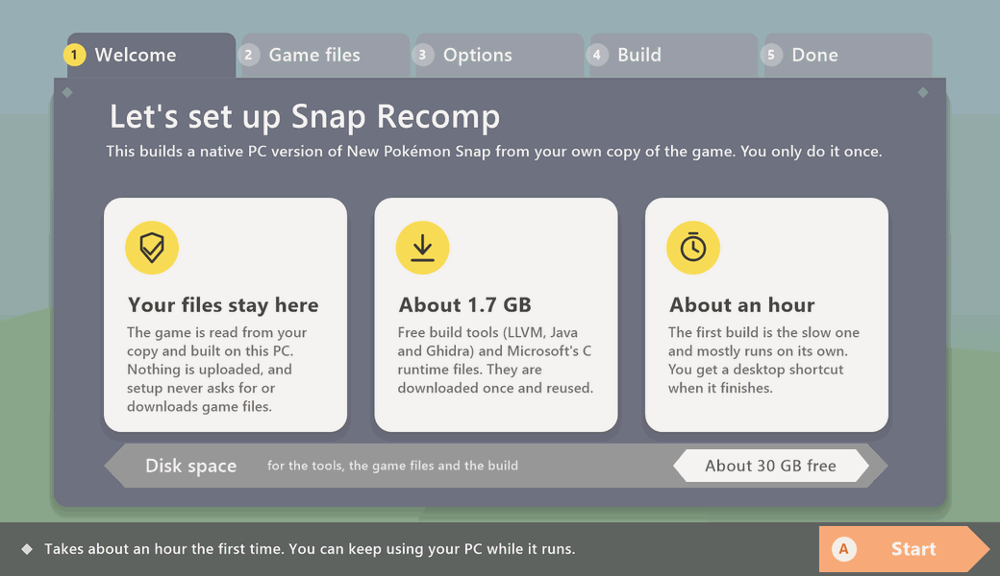
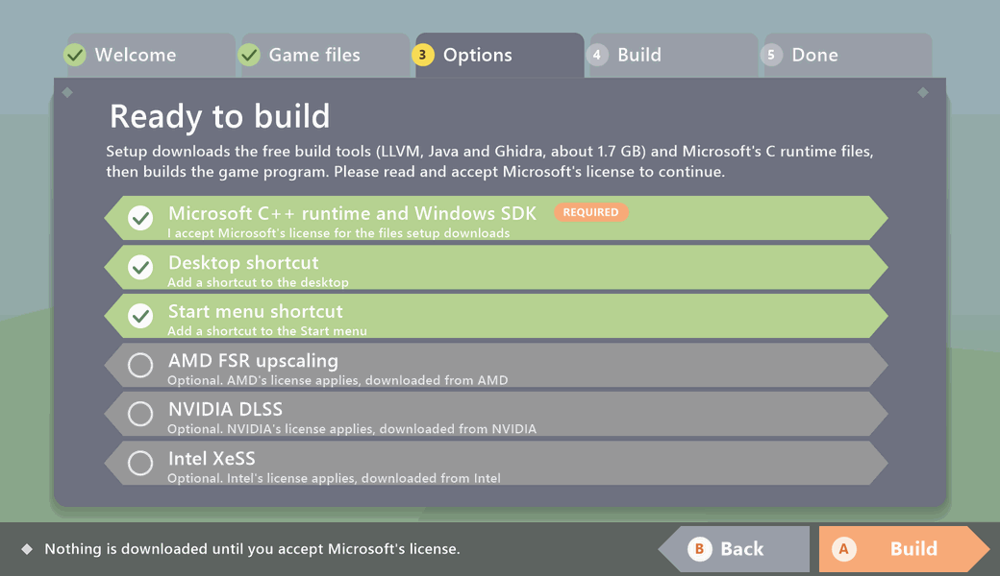
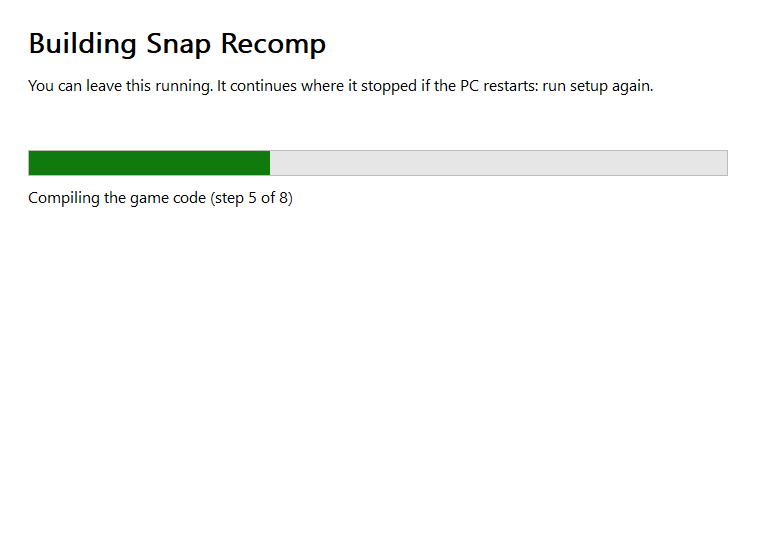
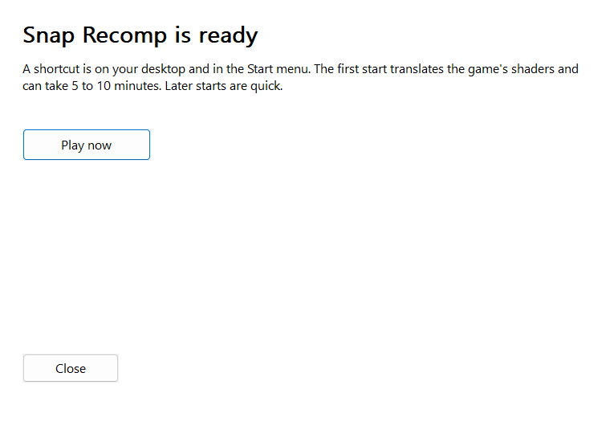
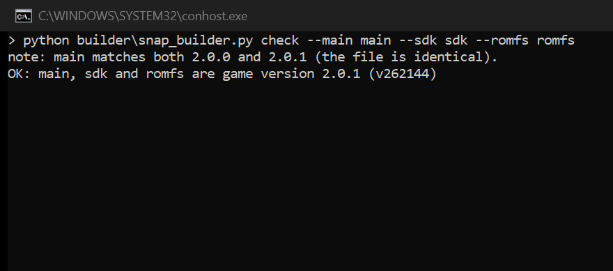
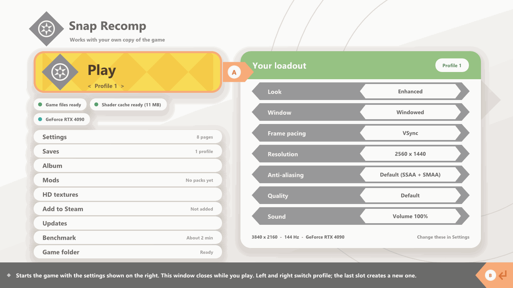

# Snap Recomp Builder for Windows

Works with your own copy of New Pokémon Snap 2.0.1.

This builder turns your own copy of the game into a native Windows program. It reads the files you supply, translates the game's code on your PC, compiles it and links it with the prebuilt runtime in this zip. The result is `SnapRecomp.exe` in the `out` folder of your work folder.

The easy way is `SnapRecompSetup.exe`: double-click it, pick your game folder, press Build. No terminal, no Python and no Visual Studio are needed. The manual command-line route further down still works and does the same job.

The program it makes, `SnapRecomp.exe`, opens a launcher window when you double-click it.

The download holds no game data and does not help you get any. You need a legal copy of the game, version 2.0.1, and you dump it yourself with your own tools.

## One-click setup

1. Double-click `SnapRecompSetup.exe`.
2. Choose your game folder. Drop it on the window or press Browse. It can be:
   - a folder with the extracted `main`, `sdk` and RomFS, or
   - a folder with your dumped base game (XCI or NSP), your update NSPs and your `prod.keys`.

   Setup finds the files itself. With a raw dump it picks the base game and the 2.0.1 update (older updates in the folder are ignored) and extracts what it needs into its own work folder. Your dump is read in place and never changed. Keys are read where they are, never copied, and are not written to any log. If setup looks for `prod.keys` in an emulator folder, it asks first. If the 2.0.1 update is missing it says so and stops.
3. Check the options and the disk-space line, then press Build. One bar shows the stage and the time left. "Show details" opens the log. If something fails, the message says what to do and Retry picks up where it stopped. Closing setup or a reboot loses nothing: start it again and it continues.
4. Setup downloads the build tools from their publishers and checks every file against a pinned SHA-256 hash. The Windows SDK pieces come from Microsoft after you accept Microsoft's license in the wizard. They are not in the download.
5. At the end you get a desktop and a Start menu shortcut and a Play now button. HD textures and upscalers are optional pages; each vendor license is shown before anything downloads.






Setup remembers your game folder. A repair, a rebuild or an update reuses it without asking. "Change game folder" is on the maintenance page. If the files moved, it asks once.

Run `SnapRecompSetup.exe` again later to Repair (rebuild with the same game files) or Uninstall (removes the shortcuts, the built program and the game data setup extracted; the build tools and your saves stay unless you tick the matching box; your own game files are never touched). Nothing is deleted behind your back while the game is installed: the extracted RomFS stays, because the game reads it every time it runs.

Time: the first build takes about an hour on a fast PC, most of it the Ghidra step (15 to 30 minutes) and the compile. The last step starts the new game once to check it reaches the title screen. That first start translates the game's shaders and takes about 8 minutes, so setup waits up to 20 minutes before it calls it a failure. A rebuild with the same game files takes a few minutes.

Space: plan on about 30 GB of free disk space. A finished install keeps about 22 GB (measured: 12 GB of game data and build files, 8 GB of build tools, 2 GB of shader cache). The wizard shows the exact figure for your PC before you press Build.

Known issue: Windows SmartScreen may say "Windows protected your PC" because the exe is not code-signed (a certificate costs money, and this is a free project). Click "More info", then "Run anyway". The update signature (Ed25519) is checked by the updater, and the SHA-256 of each release is on the release page.

Updates arrive the same way: the launcher offers them, one click installs one. If an update changes the runtime ABI, the new release carries matching prebuilt objects and the updater regenerates and recompiles the game code once (the slow Ghidra step is reused). Your working build stays as "previous" until the new one passes its smoke test.

Before an update or a rollback changes anything, the updater copies your saves and settings to a dated folder (`update-backups`, the newest 3 are kept) and stops if the drive is too full for the copy. The launcher's Updates page has an Update channel row: Stable (the default) offers finished releases, Testing also offers early builds. To keep everything in one folder, put an empty `portable.txt` next to `SnapRecomp.exe`; settings, saves and caches then live in `portable_data` beside it and survive updates. Details: `docs/updater-safety.md`.



## Manual route (advanced)

Everything above can be done from a terminal. The sections below describe that route.

## What you need

| Need | Notes |
|---|---|
| Windows 10 or 11, 64-bit | The CPU needs AVX2 (any CPU since about 2015). |
| A Vulkan 1.3 graphics driver | Needed to run the game and for the last build step. |
| Python 3.14 | Only to start the builder. The builder installs its own pinned Python packages with `pyenv`. Python 3.14 is what was tested. |
| Microsoft C runtime and Windows SDK files | Either Visual Studio Build Tools 2022 (the "Desktop development with C++" workload, free from Microsoft), or the files that `python builder\snap_builder.py winsdk --accept-license` downloads from Microsoft after you accept their license. `build --winsdk auto` (the default) uses Visual Studio when it is installed. |
| Your game files | For the command line: `main` and `sdk` from the game's program files, and the patched RomFS folder, all from version 2.0.1. `SnapRecompSetup.exe` also takes your dumped base game (XCI or NSP), the update NSPs and your `prod.keys`. |
| Disk and memory | About 15 GB free on the drive that holds the tools, the work folder and the caches (measured on a clean PC: the unpacked tools 5.5 GB plus 1.6 GB of kept downloads, the work folder 3 GB, the builder's caches 0.6 GB, and the shader cache about 2 GB after the first start). 16 GB of RAM for the Ghidra step, 8 GB without it. |
| Internet, once | To download the pinned build tools and, if you choose, upscalers. |

## Steps

Open a terminal in the folder you unzipped. Every command below is one line.

1. Check your files (about a second). It stops with a plain message if something is wrong, for example a RomFS without the 2.0.1 update:

   ```
   python builder\snap_builder.py check --main <main> --sdk <sdk> --romfs <romfs folder>
   ```

2. Download the build tools. It asks before each download, shows the size and checks the SHA-256 of every file against the pinned value (LLVM about 0.9 GB, Ghidra 0.6 GB, JDK 0.2 GB). Add `--yes` to answer yes to all:

   ```
   python builder\snap_builder.py fetch llvm ghidra switch_loader jdk
   ```

3. Make the Python environment from the pinned packages:

   ```
   python builder\snap_builder.py pyenv
   ```

4. Build into a new empty folder. The first build runs Ghidra to find the game's functions. Plan on 15 to 30 minutes for that step; the rest takes 10 to 20 minutes:

   ```
   python builder\snap_builder.py build --main <main> --sdk <sdk> --romfs <romfs folder> --work <new empty folder>
   ```

   The builder finds the tools and the Python from steps 2 and 3. Without Visual Studio Build Tools, run `python builder\snap_builder.py winsdk --accept-license` once before this step. The build ends with a smoke test: it starts the new `SnapRecomp.exe` on a scratch profile and waits for the title screen. If the check fails, nothing is switched and the log (`builder.log` in the work folder) says why.

5. Double-click `<work folder>\out\SnapRecomp.exe`. It opens the launcher: Play, change the game folder, open the save folder, import or export a save, upscalers, HD textures, updates.

   

The first start translates the game's shaders and takes several minutes. Later starts are fast.

## What it never does

- It never copies, uploads or ships your game files. It reads them and writes only inside the work folder and its own caches (`%LOCALAPPDATA%\SnapRecomp`).
- It never downloads anything without asking, and it checks every download against a published hash.
- Upscalers (FSR, DLSS, XeSS) are not in this zip. The launcher can fetch them from their publishers after you read and accept each license.

## HD textures (optional)

The launcher's "HD textures" entry makes sharper textures from your own game files with an AI model that runs on your graphics card. The choices are Off, Sharp (quickest), HD, Ultra and Custom. First capture the textures your save has unlocked: the launcher plays each course hidden and muted and keeps what the game loads. Then pick a level. The launcher shows the texture count, the time, the disk space and the video memory the busiest course needs, and stops if your card cannot hold it. Each AI tool and model is downloaded from its author after you read and accept its license, and nothing leaves your PC. Off turns the pack off and deletes nothing. `builder\HD-TEXTURES.md` lists every level and the command-line options.

## Updates

The launcher checks once a day for a new release of this builder. The check runs in the background, so Play never waits for it. It only tells you what is new, the download size and about how long the rebuild takes. Nothing installs until you click Install. Turn the check off in the launcher under Updates.

An update is signed. A bad signature, a changed file or an older version is deleted and changes nothing. The new build must pass the self-test and the smoke run before it replaces your working one, and "Go back to the previous version" restores the last one. Saves, settings and mods are never touched.

## More

`builder\README.md` has the reference: every option, the build steps, the cache and the update details. `THIRD_PARTY_NOTICES.md` and the `licenses` folder list the third-party code and its licenses.

GPL-3.0 with the section 7 DLSS/Streamline/XeSS additional permission, see `LICENSE`. Releases up to and including v1.1.0 were MIT-licensed. See `LICENSE-MIT` for that text. Third-party components retain their own licenses.
